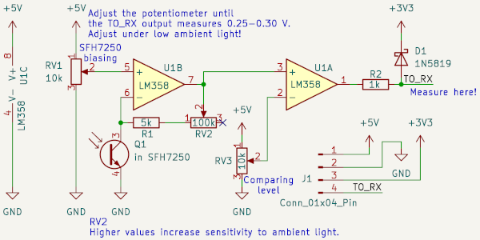
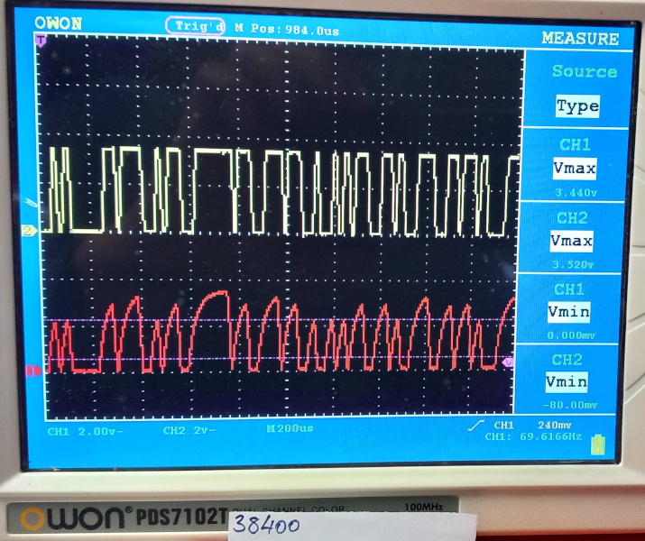
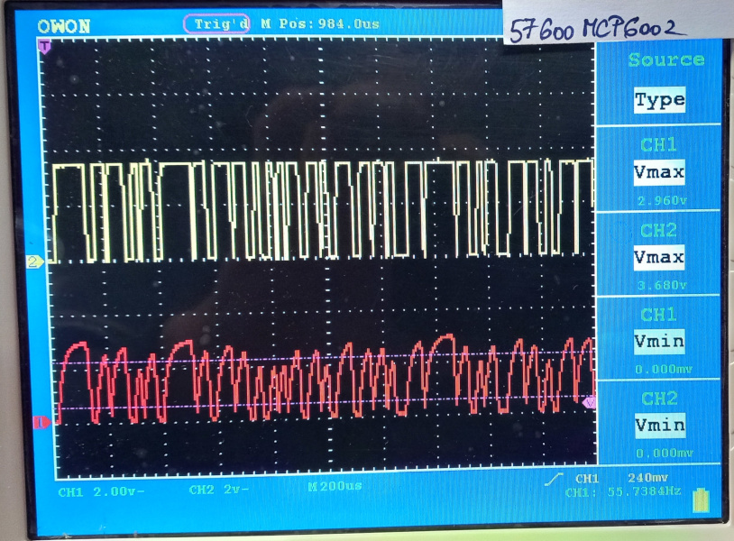
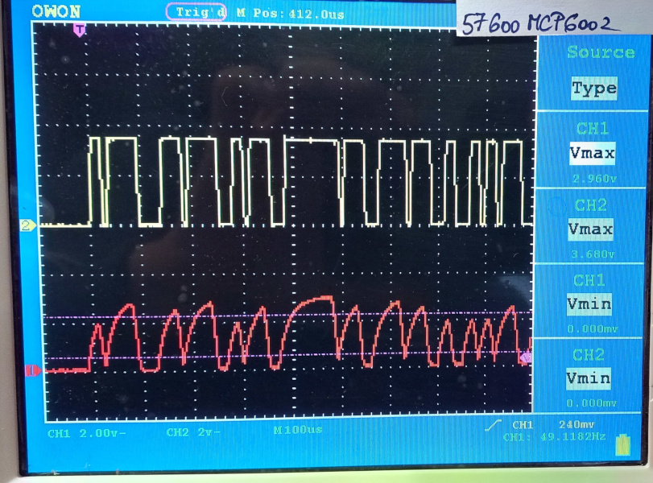
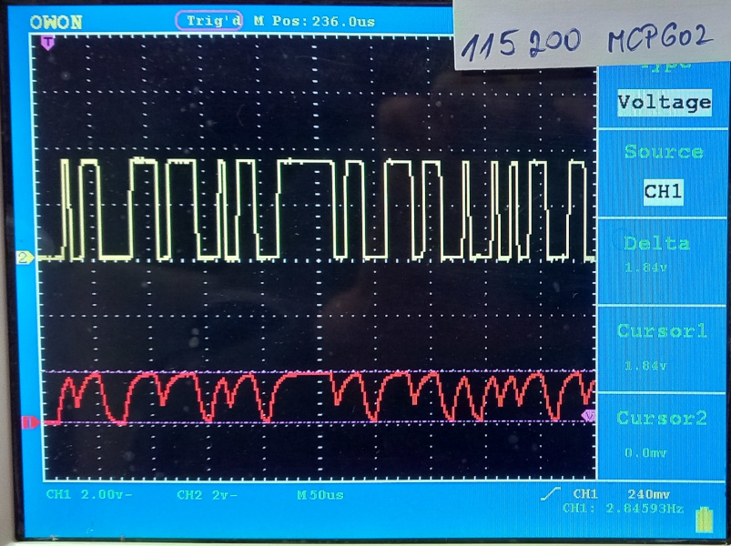
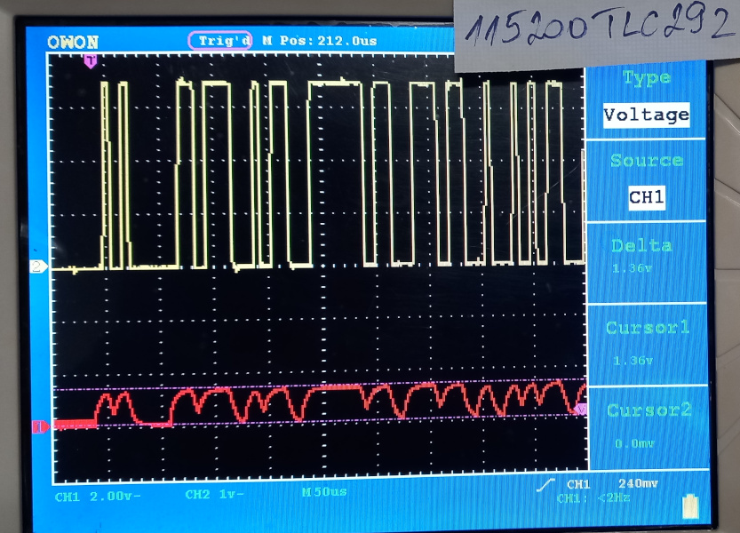
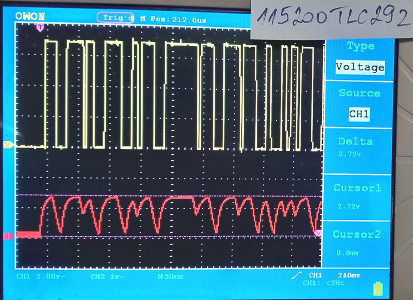
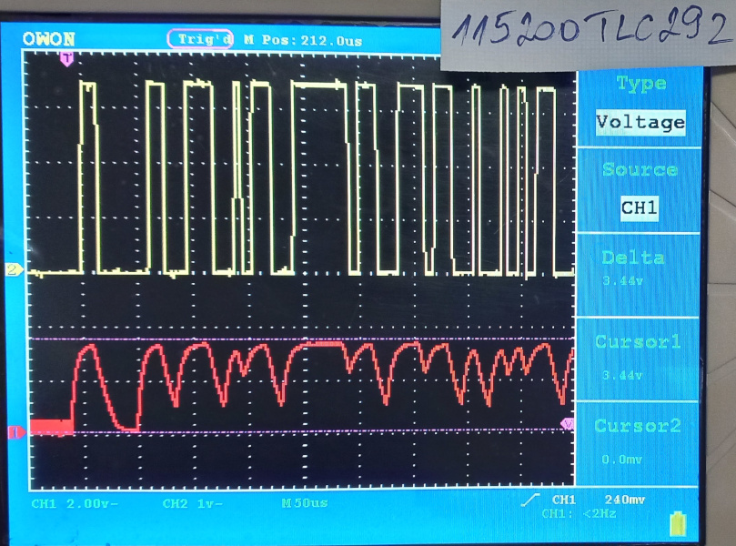
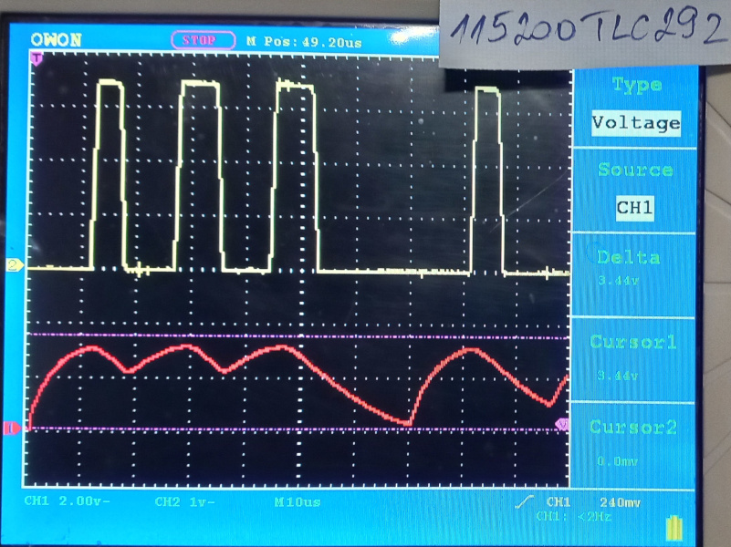

# Circuit analysis
2026-NOV-10

The test results obtained with several operational amplifiers are presented in the figures below. The fundamental concept of the circuit is that the first amplifier stage operates as a transimpedance amplifier. The potentiometer connected to this stage allows adjustment of the SFH7250 receiver's operating point. Unlike the simplified version, where the operating point adjustment was limited, the 0.25 V restriction no longer applies, allowing the circuit to be tested over a wider operating range. Practical experience and measurement results indicate that the [previously estimated value of 0.25 V](https://github.com/villgzs/FreeMDU/blob/hardware/hardware/veroboard/README.md) is, nevertheless, very close to the optimal setting.

The sensitivity of the circuit can be adjusted using the second potentiometer. At lower sensitivity settings, the adjustment of the first potentiometer has a less pronounced effect. [For the final configuration](https://github.com/villgzs/FreeMDU/tree/hardware/hardware/veroboard), no further modification appears necessary, as a setting between 20 and 40 kΩ provides optimal results. [An exception](https://github.com/villgzs/FreeMDU/blob/hardware/hardware/challenges/README.md) applies when the illumination from the PC port is particularly weak, in which case a resistance value of 100 kΩ may be required.

The second amplifier stage operates as an analog comparator. The oscilloscope waveforms show that, near the upper speed limit, the signal transitions become increasingly rounded. It can also be observed that the signal voltage only begins to move towards the intended binary state but does not reach either 0 V or the maximum output voltage. Instead, it oscillates between these levels. The comparator reference voltage can be adjusted using the third potentiometer, ensuring clearly defined LOW and HIGH output states that can be easily processed by the ESP32-C3. Since the microcontroller input also has an internal switching threshold, [the simplified version](https://github.com/villgzs/FreeMDU/blob/hardware/hardware/veroboard/README.md) can operate correctly even without a dedicated comparator.

Among the tested operational amplifiers, the TLC292 provides the highest slew rate. With the MCP602, a configuration capable of supporting 115200 baud transmission can still be achieved, although with very little operating margin. The TLC292 offers greater tolerance to variations in lighting conditions, significantly increasing the likelihood of reliable data transmission through the PC port. According to the datasheet, [another component is available](https://github.com/villgzs/FreeMDU/blob/useful/useful/bandwidth.md) with approximately twice the slew rate of the TLC292, potentially providing even greater reliability at 115200 baud. Further testing of this component may therefore be worthwhile.

# MAXIMUM TRANSFER SPEED

## LM358 (Texas) - 38400 baud

## MCP6002 (Microchip) - 57600 baud

## MCP 602 (Microchip) - 115200 baud

## TLC292 (Texas) - 115200 baud

