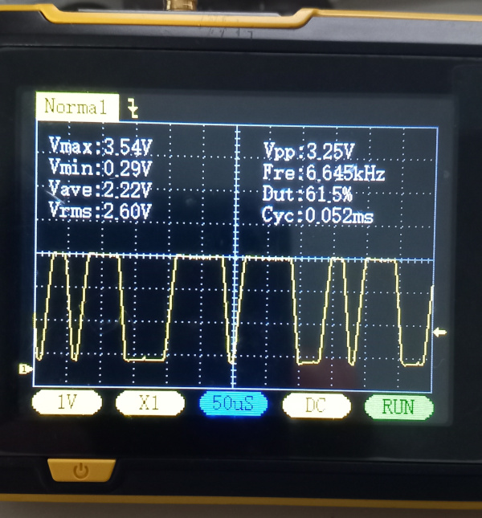
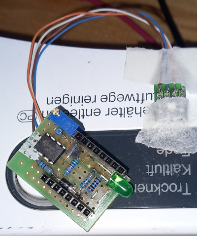
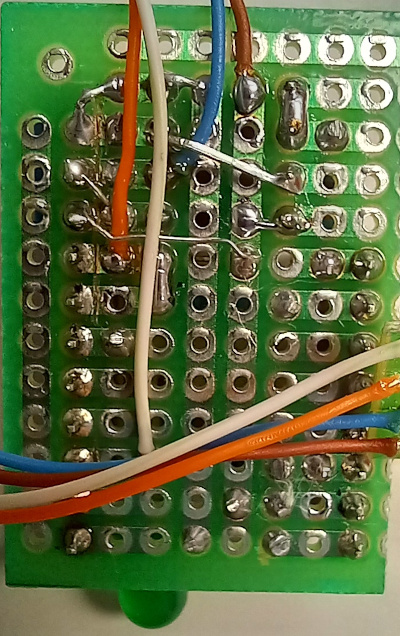
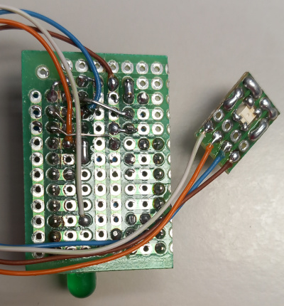
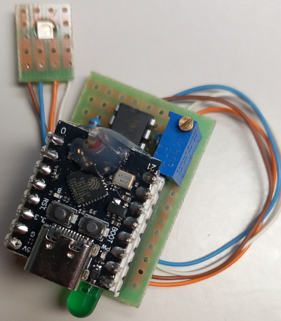
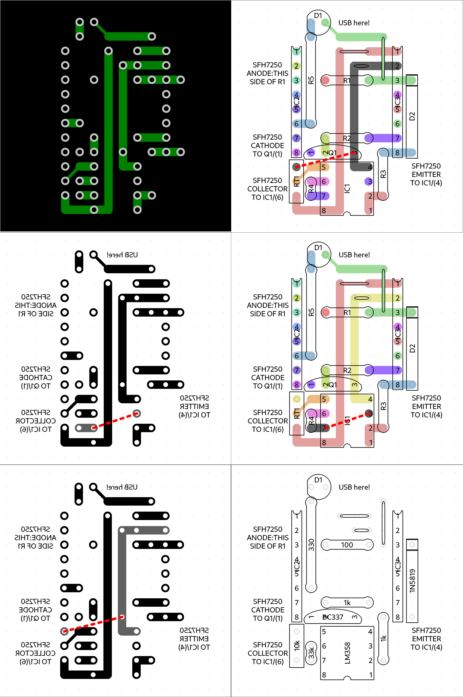
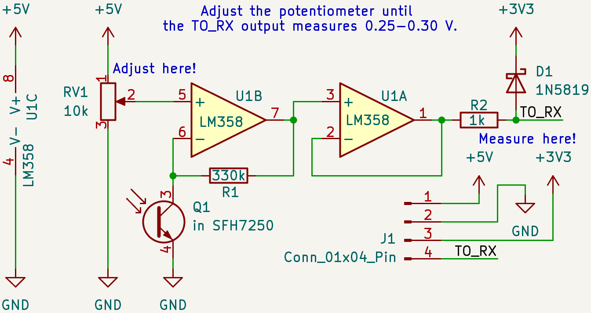

# Transmitter design with LM358

Transmission at 38400 baud without error (far from 2400 baud):

[VEROBOARD DESIGN](lm358.vrt)

   

The design above use different part names ( R1 <-> R4, R2 <-> R3, RV1 <-> RT1 )

