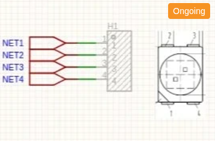
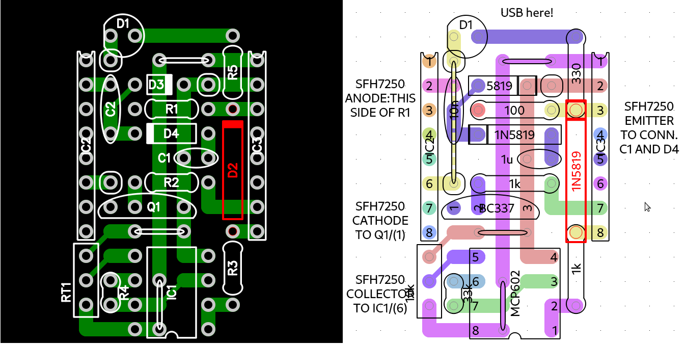

# For baud rate at 115200

[The SMD version with the schematic is available on EasyEDA.](https://oshwlab.com/villgzs/project_vwzfpawq)

Upgraded version of the LM358 design. LM358 replaced by MCP602 (higher slew rate)

There is a charge pump in the circuit for generate negativ voltage for SFH7250 emitter.

[Designed by Veroroute](https://sourceforge.net/projects/veroroute/)

